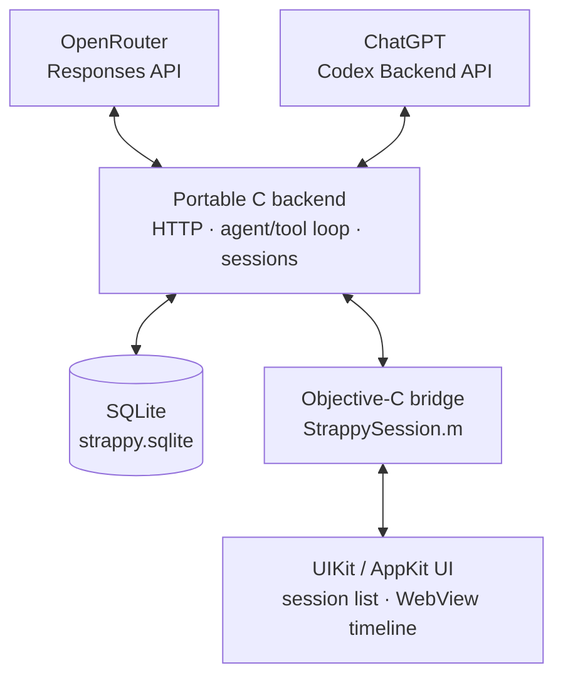

> [!NOTE]
> **AI Disclosure:** Strappy has been lovingly crafted for retro Apple devices
> by me. Also the writing in this README and associated blog post is 100%
> written by me. That said, the code is 100% AI generated.

# Strappy AI

Strappy AI is like Siri AI but for jailbroken iPhones running iOS 5+ and
Mac OS X Tiger 10.4+. Strappy scans your home folder for SQLite databases
and exposes them to an LLM through read-only tools so that you can ask
questions about your text messages, calendars, notes, music, and even third-
party apps.

> Strappy is my personal strap-on AI harness. Strappy has a big, sassy, and very
> gay personality… I mean, Strappy's physical embodiment is a rainbow-colored
> strap-on AI harness. And like most gays, Strappy is insanely diligent,
> detail-oriented, and strict… like dominatrix-strict. But why? Well, to
> be honest, I am kind of getting bored of the monotone and direct answers we
> are getting from the models by default.

For the rest of the development story quoted above, see 
[my blog post](https://jeffburg.com/unenshittification/2026/08/10/Strappy.html).

## Demos Videos

These videos are recorded on iOS 6 on my real iPhone 5 that I daily drive. It's
fully loaded with iCloud Mail, Contacts, Calendar as well as my RSS Feeds,
Podcasts, Music, iMessages, and LINE Messages. This gives Strappy plenty of
"meat" to work with in terms of database contents

| Personal Assistant | Coding Assistant |
|:---:|:---:|
| <a href="https://jeffburg.com/assets/images/unenshittification/strappy/03-vacation-gemini.mp4"></a> | <a href="https://jeffburg.com/assets/images/unenshittification/strappy/05-pokedex-luna.mp4"></a> |
| Personal Assistant mode answering a question about where and when my upcoming family vacation is on my iPhone 5 | Coding Assistant mode "one-shotting" a Pokedex App and then launching it on my iPhone 5 |

For the more demo videos, see 
[my blog post](https://jeffburg.com/unenshittification/2026/08/10/Strappy.html).

## Modes

I built the harness to have 4 modes (3 user accessible) to help limit the tools
available in each mode so that smaller models do not get confused.

| Mode | Additional access |
|---|---|
| World Knowledge | Basic LLM chatbot with available web search |
| Personal Assistant | Siri AI-like experience by making your whitelisted SQLite databases available to the LLM |
| Coding Assistant | Coding Agent-like experience with 4 basic tools, read, write, edit, bash |
| Database Study | Special automated mode to ask the LLM to pre-study your whitelisted SQLite databases to save tokens in future Personal Assistant prompts |

### Tools by Mode

| Tool | World Knowledge | Personal Assistant | Coding Assistant |
|---|:---:|:---:|:---:|
| `web_search` | Optional | Optional | Optional |
| `web_fetch` | Optional | Optional | Optional |
| `database_list` | — | Yes | — |
| `database_query` | — | Yes | — |
| `database_context` | — | Yes | — |
| `file_read` | — | — | Yes |
| `file_write` | — | — | Yes |
| `file_edit` | — | — | Yes |
| `bash` | Optional | Optional | Optional |
| `datetime_to_iso8601` | Yes | Yes | Yes |
| `datetime_from_iso8601` | Yes | Yes | Yes |
| `fontawesome_search` | Yes | Yes | Yes |
| `fontawesome_confirm` | Yes | Yes | Yes |
| `memory_read` | Yes | Yes | Yes |
| `memory_save` | Yes | Yes | Yes |
| `memory_delete` | Yes | Yes | Yes |
| `skills_list` | Yes | Yes | Yes |
| `skill_read` | Yes | Yes | Yes |
| `session_rename` | Yes | Yes | Yes |

Sources: [`GuidanceTools.json`](https://github.com/jeffreybergier/Strappy-Cocoa/blob/main/source/shared/Resources/GuidanceTools.json) and
[`AssistantSets.json`](https://github.com/jeffreybergier/Strappy-Cocoa/blob/main/source/shared/Resources/AssistantSets.json).

## Architecture

Strappy is a JSON HTTP client for the OpenAI Responses API. I tried to make the
C core portable so it can be tested in the Linux-based 
[Docker Container](https://github.com/jeffreybergier/AltivecIntelligence). 
The C "backend" handles HTTPS with libcurl, JSON with cJSON, SQLite storage,
tools, the harness loop, and sends NSNotifications to the UI layer. This allowed
me to keep the Objective-C UI layers thin. The UI layers are written in UIKit
and AppKit, except for the primary harness/chat/prompt view which is a webview.



### Rules

- [`strappy_cocoa.h/c`](source/shared/strappy_cocoa.h): To keep the C code 
   portable, this is the only file that can use Apple-specific C libraries 
   like CoreFoundation
- [`StrappySession.h/m`](source/shared/StrappySession.h), [`FileScanner.h/m`](source/shared/FileScanner.m): 
   To keep C code out of the Objective-C code, these files are the only
   Objective-C files that can import the C "backend"
- Linux test suite runs in the docker container and tests the C "backend"
- Session sidebars read a consistent SQLite snapshot, fetch 32 lightweight
  summaries per page, and cache at most 128 summaries. Processing state is part
  of each summary: rendering and edit-availability callbacks never open the
  live database. Scoped run changes from the C store feed read only that
  session's committed boolean on the monitor worker and push it to the main
  thread; only the affected visible rows refresh. Status overrides survive page
  eviction and pending snapshot replacement. Global/reconnect and structural
  changes still replace the ordered snapshot. Deletion rechecks live state.
  Both platforms cache their blue processing/unread icons, with processing
  taking precedence. Date sections store
  ranges rather than copies of every session. The `session_activity` table is
  populated once for existing histories and maintained transactionally by
  triggers; activity follows the last conversation item by sequence, falling
  back to creation time. Renaming or changing options does not move a session.
  The offline `sidebar_harness` tests ordering, snapshot isolation, backfill,
  cascades, and indexed paging with 20,000 sessions, and prints a local timing
  comparison against the eager loader (which also benefits from the new index).
- Native session-list regressions use an isolated 20,000-session fixture. Export
  it after building the host harness:

  ```sh
  STRAPPY_SIDEBAR_FIXTURE="$PWD/build/tests/sidebar-fixture.sqlite" \
    build/tests/linux/daemon/sidebar_harness
  ```

  Run `python3 source/daemon/tests/session_scroll_test.py macOS` or `iOS` to
  build the actual AppKit/UIKit cell tests. Stage the Mac ZIP below `~/Desktop`
  and run its executable there. Install the isolated iOS test IPA with `appinst`
  and launch `strappy-session-scroll-test://run`; its container's
  `Documents/session-scroll-result.txt` must report PASS. A crash or RUNNING
  marker is a failure. Tests trap live status queries from cells, exercise cache
  eviction, status pushes, scroll jumps, refresh races, and icon precedence.
  Build the C database regression with:

  ```sh
  make -C source/daemon/tests -f native.mk PLATFORM=macOS \
    TEST_PRODUCTS=sidebar-probe debug
  ```

  Use `PLATFORM=iOS` for the phone and deploy its
  `Intermediates/signed/sidebar-probe`. On 2026-10-18, both native suites passed
  on x4-vm (Tiger PowerPC) and koolphone5 (iOS 8.4.1 armv7). For 128 status
  accesses, the former per-row reader took 3,436 ms on Tiger and 1,151 ms on the
  phone; paged cached reads took 18.88 ms and 6.08 ms respectively. These are
  data-access microbenchmarks, not measured scrolling frame rates.
- Database preferences use a read-only catalog snapshot with a temporary SQLite
  index of the filtered row order. Full records load in pages of 32 with a
  128-row cache; application sections and selection lookup use only metadata.
  Search and column changes reuse prepared display/search keys. Substring search
  remains linear in catalog size and preserves Foundation's Unicode matching;
  typing is debounced by 150 ms. Scan batches post coalesced invalidations rather
  than full catalog arrays, with a final refresh even after a partial failure.
  The offline `catalog_harness` checks 20,000 rows, bounded page-query work,
  filtering, sorting, identity lookup, and snapshot isolation. Run
  `make -C source/daemon/tests catalog-foundation-test` with GNUstep installed to check
  the actual Objective-C cache, Unicode search, lazy sections, and notifications.
- Model preferences use provider-owned rows directly, with the same 32-row
  paging and 128-row cache. SQLite retains temporary search/sort keys for a
  consistent snapshot; provider section counts and model-ID selection do not
  hydrate rows. Search preserves the original combined fields and Foundation
  Unicode matching, with a 150 ms typing delay. Account, catalog, whitelist,
  and default-model changes refresh the snapshot after persistence. Model
  pickers retain their existing allowed-model APIs. `model_list_harness` checks
  21,000 models against the eager loader, all column sorts, default protection,
  account visibility, snapshot isolation, and bounded query work. The optional
  `make -C source/daemon/tests model-rows-test` checks Unicode search, cache eviction,
  metadata-only access, and deferred read errors using GNUstep.
- `make -C source/daemon/tests session-sections-test` checks session date grouping,
  calendar boundaries, daylight-saving transitions, and the Tiger calendar
  fallback. This optional Foundation harness requires `libgnustep-base-dev`
  and an Objective-C compiler on Linux.

### Completion notifications

Outstanding merge acceptance, cleanup and optional research are tracked in the
[root notification checklist](TODO.md).

On iOS, strappyd sends a completion alert after committing a successful or
failed prompt when that session is not being observed by the app. The bulletin title is the chat's
name (up to 100 Unicode characters); its body contains the first 400 Unicode
characters of the final answer. Failed bodies use `Error`, with a short
explanation for recognized credential/configuration errors. SpringBoard controls
how those fields appear on the lock screen and in unlocked banners. Raw provider
diagnostics are not shown. Cancellation, shutdown interruption, and background
Database Study do not produce alerts.

strappyd dynamically loads UserNotifications and selects the modern route when
`UNUserNotificationCenter` exists. It initializes the center for Strappy's bundle
identity, requests alert/sound/badge authorization using the proven daemon SPI,
and submits completion notifications directly. No permission UI is added to
Strappy. The daemon's signed entitlement allows only Strappy's bundle identity.
Glass uses the Mail-style tone-topic API when available, with default sound as
the fallback. Modern framework calls run on a separate worker; completion
submission only enqueues a bounded copy of the preview.

When that class is absent, the existing BulletinBoard provider handles alerts
and badges. The DEB includes that provider, loaded by SpringBoard without a
MobileSubstrate filter. It publishes with Strappy's name/icon, Notification
Center history, notification settings, and Glass sound. SpringBoard must restart
after installation or provider updates on this legacy route. The provider uses
runtime-checked private APIs on iOS 6 and later, including the iOS 8 icon lookup.
Sound and presentation follow the system's settings on both routes.

Alert delivery remains best-effort: a missing or busy
receiver never affects the prompt result. Per-session unread flags persist in
SQLite; the badge counts unread sessions. Opening a session immediately clears
its flag and sends the current absolute count, including zero, without an alert.
Badge updates use a durable latest-value queue and acknowledgments/retries.
Observation ends on navigation away or backgrounding; connection loss and a
15-second lease also prevent indefinitely stale observation. See the
[policy and timing table](docs/session-unread-notification-plan.md),
[native findings](docs/ios6-notification-provider.md) and
[production migration procedure](docs/ios6-provider-migration.md). The package
and unread/badge implementation are installed on gomadango. The owner confirmed
observed-session suppression, foreground alerts for another session, background
alerts, and badge transitions 2 → 1 → cleared by opening each unread session.

As of 2026-10-19, build `8a0f436` is installed on pinkphone-rsa (iOS 15 modern
route), koolphone5 (iOS 8 legacy route), and gomadango (iOS 6 legacy route).
The owner confirms pinkphone notifications and its startup-warning fix, and
confirms gomadango is working. See the
[latest deployment and acceptance record](docs/session-unread-notification-plan.md#latest-production-deployments-2026-10-19)
for verification scope, rollback artifacts and remaining checks.

Offline daemon coverage, including Unicode previews, errors, durable retries,
cancellation and a missing receiver:

```sh
make -C source/daemon/tests execution-test
```

Mac continues to use AltivecCocoa's `AILocalNotificationCenter` for app-owned,
background-only alerts and foreground cleanup. Build the offline macOS delegate
recorder with `python3 source/daemon/tests/notifications_test.py macOS`, then run
`build/tests/notifications/macOS/output/macOS/release/Strappy/Strappy.app/Contents/MacOS/Strappy`
on a Mac. Recording tests do not establish native banner display. The old iOS
app-delegate fixture has been retired with app-side completion submission.

### Warning Flags

Because the code is AI generated, I try to use Clang to help me as much as
possible. So the warnings enabled are pretty strict. Also I configured
Clang static analysis to run over the source as well. In both cases,
warnings and errors are not allowed.

That being said, Objective-C and C are not like Swift. In most cases to get
rid of the warnings, you just need to cast the type of number which really
doesn't do anything. But oh well, I didn't pick these languages. They are 
just what is required to make an app work on a 20 year old version of Mac OS X.

- iOS Clang app sources: -pedantic, -Wall, -Wextra, -Wconversion, -Wsign-
  conversion, -Wfloat-conversion, -Wimplicit-function-declaration, -Wobjc-
  method-access, -Wunguarded-availability, -Wno-unused-command-line-argument,
  and -Wno-semicolon-before-method-body.
- iOS Clang shared sources: the same flags.
- Modern macOS Clang sources: -Wall, -Wextra, -Wsign-conversion, -Wfloat-
  conversion, and -Wno-semicolon-before-method-body.
- Legacy macOS GCC sources: -Wall and -Wextra.
- Linux Clang test suite: -Wall, -Wextra, -Wconversion, -Wsign-conversion, and
  -Wfloat-conversion.

## Database Scanning

Strappy scans your home folder for SQLite databases and does its best to 
identify which application made the database. It then presents the databases
in a whitelisting UI so you can choose which databases the LLM should have
access to.

Strappy only opens whitelisted databases and always in read-only mode:

- `SQLITE_OPEN_READONLY`
- [SQLite authorizer](https://www.sqlite.org/c3ref/set_authorizer.html) 
  blocking writes, PRAGMA, ATTACH, and transactions
- 100-row result limit

Query results are sent through OpenRouter to the selected model provider. Use
[OpenRouter Guardrails](https://openrouter.ai/docs/guides/features/guardrails)
to control which upstream providers may receive your data. If you are using
your ChatGPT subscription, then your data is being sent to OpenAI. Strappy
makes no other network requests.

## Coding Assistant

Coding Assistant can read, write, and edit files in a selected directory. Any
mode can optionally enable Bash. For the Mac, install Xcode or another command-
line development environment. For the iPhone, install Clang and related tools
through a package manager or use the
[Altivec toolchain](https://github.com/jeffreybergier/AltivecIntelligence/releases).

> **Warning:** The coding assistant is not sandboxed in any way. Please be careful.

## Compatibility

| Platform | Architecture | Support | Tested | Package |
|---|---|---|---|---|
| iOS | armv7/arm64 | 5+ | 6, 8, 15 | `.deb`; jailbreak required |
| macOS | PPC/i386/x86_64/arm64 | 10.4+ | 10.4–10.6, 10.8, 10.9, 10.14, 15 | zipped `.app` |

Modern macOS does a lot to protect user folders and databases. To ensure Strappy
can access all of your data, I recommend giving Strappy full disk access
permissions in System ~~Preferences~~ Settings. However, I had trouble getting
this setting to stick until I signed the application with a Self-Signed
certificate. So if you are still getting prompted to access folders and can't
see critical databases like Calendar, AddressBook, chat.db, etc, then ask your
favorite AI to use the `security` CLI to create a Self-Signed code-signing
identity, then sign Strappy. After that, remove Strappy and re-add it in the
full disk access security settings.

I may look into distributing the app already signed with my self-signed
certificate but I am not sure if that will make it easier or harder to open with
or without gatekeeper getting in the way.

## Install from Releases

Strappy requires either an [OpenRouter](https://openrouter.ai/) API token or a
ChatGPT subscription. 

Note that the ChatGPT OAUTH support is unofficial and unapproved.
Strappy does not try to pretend to be Codex or Pi. It identifies at itself. 
So far ChatGPT OAUTH and subscription-based token usage has worked for me, but 
it could result in your account getting banned. **Proceed with caution.**

### iOS

You need to know whether your iPhone has a rootful or rootless jailbreak. If
you don't know, try the rootful.deb file first as it will fail on rootless 
jailbreaks.

1. [Jailbreak](https://ios.cfw.guide) your iPhone
1. Install OpenSSH from the package manager
1. Download `Strappy-X.Y.Z-iOS-rootful.deb` or
   `Strappy-X.Y.Z-iOS-rootless.deb` from [Releases](https://github.com/jeffreybergier/Strappy-Cocoa/releases).
1. Install it:

```sh
scp Strappy-X.Y.Z-iOS-rootful.deb root@iphone-ip-address:~/strappy.deb
ssh root@iphone-ip-address "dpkg -i ~/strappy.deb && rm ~/strappy.deb"
```

Depending on how new your computer is and how old your iPhone is, you may
need to manually enable older RSA algorithms in order for SSH to connect:

```sh
scp -O \
  -o HostKeyAlgorithms=+ssh-rsa \
  -o PubkeyAcceptedAlgorithms=+ssh-rsa \
  Strappy-X.Y.Z-iOS-rootful.deb \
  root@iphone-ip-address:~/strappy.deb

ssh \
  -o HostKeyAlgorithms=+ssh-rsa \
  -o PubkeyAcceptedAlgorithms=+ssh-rsa \
  root@iphone-ip-address \
  "dpkg -i ~/strappy.deb && rm ~/strappy.deb"
```

### Mac

1. Download `Strappy-X.Y.Z-macOS.zip` from
[Releases](https://github.com/jeffreybergier/Strappy-Cocoa/releases)
1. Unzip it
1. Optional: If your Mac has Gatekeeper and you don't want to fight with it,
   run `xattr -d com.apple.quarantine ~/Downloads/Strappy-X.Y.Z-macOS.zip`
1. Launch it (as God intended)

### First launch

In Preferences:

1. Add your accounts (OpenRouter and/or ChatGPT OAUTH)
2. Select the models you want to whitelist
3. Scan for databases and then whitelist the ones you want
4. (Optional) Study databases to save tokens in future prompts

## Compile from Source

This project uses the Docker-based retro development environment
[Altivec Intelligence](https://github.com/jeffreybergier/AltivecIntelligence).

### BYOSDK

Altivec Intelligence is BYOSDK (Bring Your Own SDK), so you must supply the
Apple SDK archives yourself. See
[Altivec Intelligence](https://github.com/jeffreybergier/AltivecIntelligence#byosdk)
repo for details before building Strappy.

### Build from Source

**1. Clone repo**

```sh
git clone https://github.com/jeffreybergier/Strappy-Cocoa.git
cd Strappy-Cocoa
```

**2. Pull the Docker image and install the SDKs**

```sh
docker compose pull
docker compose run --rm altivec-sdk install
```

**3. Build Strappy**

```sh
docker compose run --rm make clean release
```

Outputs:

- `build/iOS/release/Strappy/Strappy-rootful.deb` for rootful jailbreaks
- `build/iOS/release/Strappy/Strappy-rootless.deb` for rootless jailbreaks
- `build/macOS/release/Strappy/Strappy.zip`

(Optional) Run the Linux-Based Tests for the C Backend:

```sh
docker compose run --rm make clean test
```

## Source map

| Path | Purpose |
|---|---|
| [`source/shared`](https://github.com/jeffreybergier/Strappy-Cocoa/tree/main/source/shared) | C core, tools, storage, prompts |
| [`source/iOS`](https://github.com/jeffreybergier/Strappy-Cocoa/tree/main/source/iOS) | UIKit app and `.deb` packaging |
| [`source/macOS`](https://github.com/jeffreybergier/Strappy-Cocoa/tree/main/source/macOS) | AppKit app and quad-fat packaging |
| [`source/daemon/tests`](https://github.com/jeffreybergier/Strappy-Cocoa/tree/main/source/daemon/tests) | Linux test harnesses |

Good starting points:

- [`strappy_responses.c`](https://github.com/jeffreybergier/Strappy-Cocoa/blob/main/source/shared/strappy_responses.c): harness loop
- [`strappy_tools.c`](https://github.com/jeffreybergier/Strappy-Cocoa/blob/main/source/shared/strappy_tools.c): harness tools
- [`strappy_db.c`](https://github.com/jeffreybergier/Strappy-Cocoa/blob/main/source/shared/strappy_db.c): database storage and retrieval
- [`AssistantSets.json`](https://github.com/jeffreybergier/Strappy-Cocoa/blob/main/source/shared/Resources/AssistantSets.json): tool definitions
- [`SystemPrompt.json`](https://github.com/jeffreybergier/Strappy-Cocoa/blob/main/source/shared/Resources/SystemPrompt.json): system prompt definitions
- [`GuidanceTools.json`](https://github.com/jeffreybergier/Strappy-Cocoa/blob/main/source/shared/Resources/GuidanceTools.json): system prompt definitions

## Contributing

Sure, I will take contributions as long as you have tested on a real iPhone or
Mac with a screenshot. Please follow the [code of conduct](CODE_OF_CONDUCT.md).

### Wish List

If you want to contribute, these are the next items I plan to add myself:

- [X] OpenAI OAUTH Support: I want to use my ChatGPT monthly plan in Strappy. This
      is sort of a gray area I think? So not sure how well this will work out.
- [ ] Improve macOS Coding Agent skill and toolchain: The mac already has a development
      toolchain in Xcode, but it changes over time. Also I need to be able to 
      provide AltivecCore and AltivecCocoa to macs (right now the toolchain only supports iPhone)
- [ ] Add arm64 support to the iPhone development toolchain.
- [ ] Remote Access: I want to be able to access Strappy on my iPhone from my computer.
    - This could be done via some sort of CLI on the iPhone that I
      can SSH into.
    - Or, this could be done by hosting a 
      [little web server](https://github.com/jeremycw/httpserver.h) 
      inside of Strappy 
- [ ] Context Management: Currently there are checkboxes on each round to allow
      full manual control of context. But I want to add an option where previous
      prompts have all of their context ignored except the original prompt and the
      final answer. This should help shrink the context a lot.

## Status and license

Strappy is experimental personal software, not a hardened product. It is
[MIT licensed](https://github.com/jeffreybergier/Strappy-Cocoa/blob/main/LICENSE), 
100% AI coded and 100% compiled.

Build roots are resolved from the project Makefile and inherited by child makes.
`BUILD_ROOT=custom` is relative to the repository root. Native artifacts live in
`build/<platform>/<configuration>/<product>/`; `BUILD_VARIANT=name` keeps an
additional build variant. Use `make macOS-clean PRODUCT=<name>` for one product,
`make macOS-clean` for a platform, or `make clean-all` for the whole build root.
CI stages release assets in `build/release` (including the release manifest).
